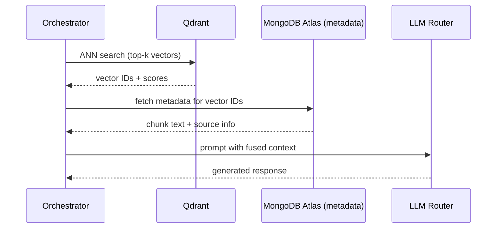

# AI System Design Blueprint for Lumenly

*Version: 1.2*
*Audience: Engineering leadership, architecture team, product managers*
*Scope: End-to-end architecture for up to **10 million** concurrent users, emphasizing **scalability**, **reliability**, **personalization**, and a **MongoDB-first** data layer.*

---

## Table of Contents

1. [Memory Engine Design](#1-memory-engine-design)
2. [Knowledge Brain (RAG) Design](#2-knowledge-brain-rag-design)
3. [Agent Framework](#3-agent-framework)
4. [AI Orchestrator Design](#4-ai-orchestrator-design)
5. [Safety Layer](#5-safety-layer)
6. [Evaluation Framework](#6-evaluation-framework)
7. [Future AI Roadmap](#7-future-ai-roadmap)

---

## 1. Memory Engine Design

| Sub-engine | Purpose | Storage |
|------------|---------|---------|
| **Working Memory** | Short-term session context (≈ 2k tokens). | In-process LRU cache (keyed by `session_id`) + **Redis** (distributed, 64 KB max per entry). |
| **Episodic Memory** | Chronological user events (messages, actions). | **MongoDB Atlas** `conversations` collection with an embedded `messages` array. |
| **Semantic Memory** | Vector embeddings of user-generated text (journals, reflections). | **Qdrant** for vectors; metadata (`userId`, `source`, timestamps) lives in MongoDB `memory_links`. |
| **Goal Memory** | High-level user goals and metrics. | **MongoDB Atlas** `goals` collection (documents contain nested progress sub-documents). |
| **Audit Log** | Immutable compliance & billing events. | **PostgreSQL** (unchanged – strict ACID requirement). |

### 1.1 Embedding Strategy (MongoDB Documents)

- **Profile & WellnessScore** → **Embedded** inside the `profiles` document (fast, single-read).
- **Messages** → **Embedded** inside a `conversation` document (`messages` array). Each conversation stays well under MongoDB's 16 MiB document limit (typical < 10k messages).
- **Journal Entries** → **Separate** collection (`journal_entries`) to support unbounded time-series queries and TTL indexing.
- **AI Insights** → **Separate** collection (`ai_insights`) for independent TTL and indexing.
- **Qdrant Vectors** → Stored *only* in Qdrant; a lightweight reference (`memory_links`) lives in MongoDB.

### 1.2 Retrieval Flow

```
1. Cache-first      → Check Working Memory in Redis
2. Hybrid retrieval → Temporal filter on episodic data (last 30 days)
                   → ANN search on Qdrant for top-k semantic matches
3. Fusion service   → Merges results, scores by recency, relevance, and personalization weight
4. Fallback         → If fusion score < 0.3, fall back to Knowledge Brain (RAG)
```

### 1.3 TTL & Decay Policies

| Data Type | TTL (after soft-delete) | Policy |
|-----------|------------------------|--------|
| `journal_entries` | 180 days | GDPR-compliant purge |
| `ai_insights` | 90 days (via `expiresAt`) | Auto-expire with a TTL index |
| `profiles.wellnessScore` | N/A (kept indefinitely) | Updated in-place |
| `memory_links` | 180 days | Periodic cleanup job |
| `conversations` | 365 days | Retained for analytics, soft-deleted after inactivity |

---

## 2. Knowledge Brain (RAG) Design

### 2.1 Overview

The **Knowledge Brain** enriches LLM prompts with personal context and external domain knowledge. It **never** uses PostgreSQL or `pgvector`; all vector work is performed by **Qdrant**, while document metadata lives in **MongoDB Atlas**.

### 2.2 Document Store

- **`documents` collection** holds raw text, source IDs, timestamps, and categorical tags.
- Each document is **immutable**; updates create a new version with a `version` field (for auditability).
- **Indexes** on `source`, `tags`, and `createdAt` support fast filtering before vector search.

### 2.3 Embedding Pipeline

```
1. Ingestion service (FastAPI) receives a document or user-generated text
2. Text is chunked (1k-token sliding window, 200-token stride)
3. Each chunk is sent to Groq (embed-3-large) or Gemini (embedding-v2) based on user tier
4. The resulting vector is upserted into Qdrant
5. Chunk metadata (MongoDB document _id, chunk offsets) is stored in memory_links
6. A Kafka topic streams the metadata for downstream analytics
```

### 2.4 Retrieval Process



**Hybrid ANN + BM25**: After retrieving top-k vectors from Qdrant, the raw text is re-ranked with BM25 (MongoDB text index) for higher precision.

**Re-ranker LLM** (tiny Claude Haiku) refines the top-20 results before they are injected into the final prompt.

### 2.5 Admin & Analytics via Atlas SQL

The MongoDB Atlas SQL Interface provides a relational view over the `documents`, `memory_links`, `profiles`, and `journal_entries` collections, enabling:

- Admin dashboards to run standard `SELECT` statements for user-level data audits.
- Analytics pipelines to compute cohort-wise metrics (e.g., average mood per month) without ETL.
- Compliance reports that query soft-deleted records via `deletedAt IS NOT NULL`.

### 2.6 Security & Privacy

- All document text is encrypted at rest (Atlas Encryption-at-Rest).
- Vector payloads in Qdrant contain only hashed identifiers; no PII travels to the vector store.
- Access to the Atlas SQL endpoint is controlled via IAM roles and IP whitelist.

---

## 3. Agent Framework

### 3.1 Core Agents (Single-Purpose, Composable)

| Agent | Responsibility | Primary Data Sources |
|-------|---------------|----------------------|
| **Life Strategist** | Long-term planning, habit formation, weekly reviews | `goals`, `journal_entries`, `profiles` |
| **Mental Wellness Coach** | Mood detection, crisis escalation, reflection exercises | `profiles.wellnessScore`, recent messages |
| **Habit Coach** | Habit creation, streaks, behavioral change | `habits`, `profiles` |
| **Learning Coach** | Skill recommendation, spaced repetition, study plans | `documents`, `memory_links` |
| **Fitness Coach** | Exercise plans, biometrics integration | `profiles`, external health APIs |
| **Career Coach** | Job market insights, resume optimization, skill gaps | `documents`, external labor-market feeds |
| **Financial Coach** | Budgeting, spending awareness, saving goals | `goals`, `profiles`, external market data |
| **Relationship Coach** | Communication coaching, conflict resolution | Conversation snippets, sentiment trends |

**Design Constraints**:
- Each agent runs as a **stateless** callable (Docker + K8s).
- Agents receive a **Context Object** (`userId`, `sessionId`, `retrievedMemory`, `personalizationFlags`) and return a structured JSON response adhering to a predefined schema.

### 3.2 Collaboration Workflow

```
1. Intent Classification   → Tiny Claude-Haiku decides primary agent(s)
2. Parallel Invocation     → gRPC; each agent returns confidence score + suggested actions
3. Fusion Engine           → Merges suggestions, resolves conflicts via rule-based priority matrix
                             (Mental Wellness > Finance for crisis scenarios)
4. Synthesizer             → Builds final user-facing response with provenance links
5. Feedback Loop           → User reactions streamed back to Goal Memory for RL-HF updates
```

### 3.3 Prompt Architecture

- **System Prompts** contain global safety guardrails and user-specific tone settings.
- **Agent Prompts** are stored in MongoDB (`agent_prompt_templates`) and versioned via Git.
- **Dynamic Context Assembly** packs relevant data (working memory, top-k chunks, goal summary) into a compressed JSON payload passed to the LLM.
- **Prompt Versioning** enables A/B testing; each rollout records `prompt_version_id` for traceability.

---

## 4. AI Orchestrator Design

### 4.1 Request Lifecycle

```
1. API Ingestion        → FastAPI receives HTTP/WebSocket request, validates JWT
2. Auth & Rate-Limiting → Per-user token bucket (max 5 RPS) enforced via Redis
3. Intent Classification → Tiny Claude-Haiku returns intent label & confidence
4. Agent Routing        → Rule engine maps intents to primary & secondary agents
5. Tool Execution       → If intent requires external APIs, isolated Tool Workers are spawned
6. Context Builder      → Pulls data from MongoDB, Qdrant, Redis; assembles payload
7. LLM Routing          → Chooses Groq (high-throughput) or Gemini (premium) per tier/latency/budget
8. Response Synthesis   → Fusion engine aggregates agent outputs, runs safety filter, formats response
9. Telemetry            → Structured logs to ElasticSearch; Prometheus metrics
```

### 4.2 LLM Routing Strategy

| Provider | Model | When Used |
|----------|-------|-----------|
| **Groq** | Claude-Opus-4.8 | Primary generation, voice-fast paths, cost-sensitive workloads |
| **Google Gemini** | Gemini-1.5-Flash | Fallback for low-cost, high-throughput queries; enterprise tier for higher fidelity |
| **Fallback** | Claude-Haiku | Safety-critical short responses, token-budget overflow |

- **Cost Optimizer** monitors per-user token usage; exceeding the user-defined ceiling triggers an automatic switch to the cheaper model.
- **Latency Optimizer** keeps a warm pool of Groq connections; Gemini is pre-warmed for enterprise traffic.

### 4.3 Voice Pipeline

```
1. FastAPI voice endpoint receives audio
2. ElevenLabs STT → transcript text
3. Transcript fed into the Coaching Orchestrator
4. LLM generates voice-ready response
5. ElevenLabs TTS → MP3 stored in Redis (TTL 5 min) → signed URL returned to mobile client
```

---

## 5. Safety Layer

| Guardrail | Mechanism |
|-----------|-----------|
| **Prompt-Injection Detection** | Regex + Claude-Haiku classifier; rewrites suspicious prompts and logs the event. |
| **Toxicity Detection** | Self-hosted Perspective API + Claude-based scorer (threshold 0.7). |
| **Crisis Escalation** | Sentiment < -0.8 AND crisis keywords present → emergency message, priority to Mental Wellness agent, HIPAA-grade log entry. |
| **Medical Disclaimer** | Deterministic rule set (no diagnosis) enforced before any health-related response. |
| **Financial Advice Guardrail** | Actionable investment suggestions capped at 5% of session output; mandatory disclaimer and user confirmation. |
| **Privacy Protection** | AES-256-GCM at rest; deterministic tokenization of identifiers before storing in Qdrant; GDPR/CCPA `/forget` endpoint triggers a Data-Deletion Worker that purges all user-related data from MongoDB, Redis, and Qdrant within 24 hours. |

---

## 6. Evaluation Framework

| Metric | Definition | Frequency |
|--------|-----------|-----------|
| **Memory Recall Accuracy** | % of retrieved memories that are relevant (precision). | Continuous (online logs). |
| **Coaching Quality** | Human-rated 1–5 score on empathy, usefulness, personalization. | Weekly curator review. |
| **Retrieval Precision** | nDCG@10 for RAG queries (top-k relevance). | Daily batch test set. |
| **Hallucination Rate** | Fraction of generated statements not supported by any source. | Continuous via self-verification agents. |
| **User Satisfaction** | NPS & CSAT collected post-interaction. | Weekly survey. |
| **Goal-Completion Impact** | Ratio of user-set goals achieved within target timeframe. | Monthly KPI dashboard. |

**A/B Testing**: Each prompt or model change creates a new `prompt_version_id`. Random 5% traffic slice runs the variant; metrics are compared with p < 0.05 significance.

**Continuous Learning**: Feedback signals feed into a reinforcement-learning loop that updates retrieval fusion weights while respecting safety constraints.

---

## 7. Future AI Roadmap

1. **Predictive Coaching** – Time-series forecasting on goal progress to proactively suggest interventions.
2. **Burnout Detection** – Combine sentiment trends, usage patterns, and optional wearable data to flag early burnout.
3. **Multi-Modal Intelligence** – Integrate voice (Whisper-V3) and image-to-text pipelines for richer interactions.
4. **Continuous Learning Loop** – Deploy online RL agents that adapt prompt phrasing based on real-time success metrics, with strict safety overrides.
5. **Federated Personalization** – Enable on-device embedding updates for privacy-preserving personalization across the 10M user base.

---

## Summary

The AI system fully embraces **MongoDB Atlas** as the primary document store, accessed through an async ODM (Beanie/Motor) in a FastAPI backend. All vector-based RAG operations rely exclusively on **Qdrant**, while metadata and user documents remain in MongoDB. The Atlas SQL Interface empowers admin and analytics teams to query NoSQL data with familiar SQL syntax, eliminating the need for separate relational replicas.

Together with Redis caching, robust safety layers, and cost-aware LLM routing, the architecture delivers a **scalable, privacy-first, and developer-friendly platform** for the next generation of AI-driven life coaching.

---

*Prepared by the Lumenly AI Core Team — 2026-06-23.*