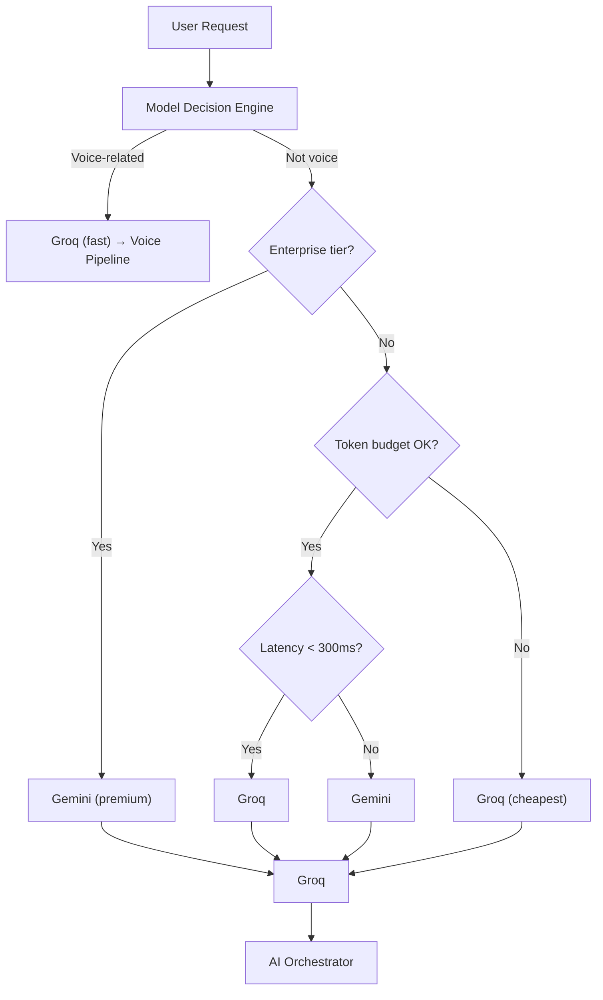

# Lumenly — System Architecture

## Overview

Lumenly is an **AI-native Life Operating System** built for 10M active users. All mutable user data lives in **MongoDB Atlas** (document-oriented, globally replicated) and is accessed via an **async ODM** (Beanie / Motor) in the FastAPI backend. Static, compliance-critical logs remain in PostgreSQL, while **Redis** provides low-latency caching and **Qdrant** stores all vector embeddings for Retrieval-Augmented Generation (RAG).

---

## 1. FastAPI Backend (Async)

| Component | Technology | Role |
|-----------|-----------|------|
| **API Layer** | **FastAPI** (async) | HTTP/WebSocket entry point, authentication, request validation |
| **ODM** | **Beanie** (built on **Motor**) | Async CRUD against MongoDB Atlas collections |
| **Background Workers** | **Celery** / **Dramatiq** (async) | Long-running tasks (embedding pipelines, analytics, nudger) |
| **Cache** | **Redis Cluster** | Session state, rate-limit counters, short-term vector metadata |
| **Vector Store** | **Qdrant** | Semantic vector storage & ANN search (no pgvector) |
| **Audit & Billing** | **PostgreSQL** | Immutable financial & compliance logs |

All FastAPI routes are fully asynchronous; database calls use `await` through Beanie's API, guaranteeing non-blocking I/O even under heavy load.

---

## 2. AI Orchestrator

- **Purpose**: Single entry point for every AI-driven workflow (coaching, recommendation, voice response).
- **Responsibilities**:
  - Authenticate via the FastAPI gateway.
  - Pull user-level personalization flags from MongoDB (`profiles` collection).
  - Enforce token-budget and cost-aware routing policies.
  - Coordinate fallbacks and retries across LLM providers.
  - Write all assistant responses back over the WebSocket.
- **Ownership**: AI Core Team.

---

## 3. Memory Engine

- **Purpose**: Privacy-first semantic memory that stores user-generated text, embeddings, and metadata.
- **Components**:
  - **Ingestion Pipeline** – chunking → embedding (via Groq or Gemini) → **upsert** into **Qdrant**.
  - **Metadata Store** – MongoDB Atlas collection `memoryLinks` holds `{userId, vectorId, source, timestamps}`.
  - **Cache Layer** – Recent vectors cached in **Redis** (TTL ≈ 10 min).
- **Memory Types**: Working, Episodic, Semantic, Procedural, Goal Memory.
- **Ownership**: AI Core Team — Memory Squad.

---

## 4. Knowledge Brain (RAG)

- **Purpose**: Retrieve-Augment-Generate pipeline that enriches LLM prompts with personal context and domain knowledge.
- **Flow**:
  1. User uploads PDF/book/notes → ingestion pipeline runs asynchronously.
  2. Orchestrator receives a query.
  3. **Semantic search** executed against **Qdrant** (top-k vectors).
  4. Retrieved chunk **metadata** (document IDs, source info) fetched from MongoDB Atlas (`documents` collection).
  5. Assembled context passed to the selected LLM.
- **Differentiator**: Enables highly specific, personalized advice grounded in the user's own reading material.
- **Ownership**: AI Core Team — RAG Specialists.

---

## 5. Agent Router

- **Purpose**: Dynamically route requests to specialized **agents** (self-contained AI workers) that solve sub-problems of a request.
- **Design**:
  - Agents are defined by JSON-Schema contracts (`input`, `output`).
  - Router executes agents **in parallel** or **sequentially** based on workflow definitions.
  - Supports fallback agents when a primary model fails or exceeds budget.
- **8 Domain Agents**: Life Strategist, Mental Wellness Coach, Habit Coach, Learning Coach, Fitness Coach, Career Coach, Financial Coach, Relationship Coach.
- **Ownership**: AI Core Team — Agent System Squad.

---

## 6. Context Builder

- **Purpose**: Assemble a deterministic, ordered payload for the LLM.
- **Inputs**:
  - Recent conversation turns (stored in the `conversations` collection, messages embedded).
  - Current wellness signals (Redis cached analytics).
  - Active goals/habits (MongoDB).
  - Retrieved memory chunks (Qdrant + MongoDB metadata).
  - Personalization flags (MongoDB `profiles`).
- **Output**: JSON `{system_prompt, user_prompt, retrieved_chunks, metadata}`.
- **Token Budget**: Enforced by trimming retrieved chunks if total context exceeds model limit.
- **Ownership**: AI Core Team.

---

## 7. Personalization Engine

- **Purpose**: Compute a **User Blueprint** (tone, depth, domain priorities) from historic behavior.
- **Process**:
  1. Analyze goal completion rates, habit adherence, interaction sentiment (MongoDB aggregations).
  2. Produce flags such as `tone = supportive`, `depth = expert`, `domains = {mental_health, finance}`.
  3. Store the blueprint in the `profiles` document (embedded field) and cache in Redis (1-hour TTL).
- **Triggers**: Background refresh triggered by `HabitCompleted` and `GoalUpdated` events.
- **Ownership**: AI Core Team.

---

## 8. Wellness Intelligence Engine

- **Purpose**: Turn raw sensor streams (heart-rate, sleep, activity) into actionable wellness scores.
- **Wellness Score** (proprietary 0–100 metric):

  | Area | Weight |
  |------|--------|
  | Sleep | 20% |
  | Mood | 20% |
  | Productivity | 15% |
  | Habits | 15% |
  | Fitness | 10% |
  | Learning | 10% |
  | Relationships | 10% |

- **Components**:
  - **Ingestion Service** – FastAPI endpoint writes sensor payloads to a **Redis stream**.
  - **Analytics Workers** (Celery) consume the stream, compute rolling averages, stress forecasts, and persist results in the `wellnessScore` sub-document inside `profiles`.
- **Ownership**: Data & Analytics Team (collaborates with AI Core).

---

## 9. LLM Router

- **Purpose**: Decide which LLM provider (Groq or Gemini) should serve a sub-task.
- **Decision Factors**:
  - **Token cost** (Groq cheaper, Gemini higher quality).
  - **Latency SLA** (voice-fast paths → Groq, target < 500ms).
  - **Model capabilities** (function calling, long-context → Gemini).
  - **User tier** (Enterprise gets Gemini by default).
  - **Current token budget** (per-user quota).
- **Ownership**: AI Core Team.

---

## 10. Voice Pipeline

- **Purpose**: Convert text responses into natural speech via **ElevenLabs** and deliver streaming audio to the mobile client.
- **Steps**:
  1. User speaks → audio streamed over WebSocket.
  2. ElevenLabs STT → transcript text.
  3. Transcript fed into Coaching Orchestrator.
  4. LLM generates voice-ready response.
  5. ElevenLabs TTS → MP3 stored in **Redis** (TTL 5 min) → signed URL returned.
  6. Mobile client streams audio.
- **Ownership**: AI Core Team — Voice Squad.

---

## 11. MongoDB Atlas SQL Interface (Admin & Analytics)

> **Why it matters:** The Atlas **SQL Interface** lets admin dashboards and analytics pipelines run familiar ANSI-SQL queries over the NoSQL collections, without materializing a separate relational store.

### 11.1 How It's Used

| Consumer | Typical Queries | What It Reads |
|----------|----------------|---------------|
| **Admin Console** | `SELECT email, isActive FROM users WHERE createdAt > ...` | `users` collection |
| **Analytics Dashboard** | `SELECT userId, AVG(wellnessScore.mood) AS avgMood FROM profiles GROUP BY userId` | Embedded `wellnessScore` in `profiles` |
| **Reporting** | `SELECT COUNT(*) AS msgCount FROM conversations_messages GROUP BY conversationId` | Child table auto-generated from `messages` array |
| **Compliance Audits** | `SELECT userId, action, performedAt FROM audit_log WHERE ...` (PostgreSQL) | Unchanged audit store |

### 11.2 Design Guidance for SQL Compatibility

- **Flat field names** (no deep polymorphic structures).
- **Arrays** only used for bounded, ordered data (e.g., `messages` inside conversations). Atlas automatically creates a child table with a deterministic schema.
- **Enum values** stored as short strings (`"coaching"`, `"goal_planning"`).
- **ObjectId** fields queried with `OBJECTID('hex')`.
- **Indexes** defined in MongoDB to back the most common SQL filters.

### 11.3 Example Atlas-SQL Queries

```sql
-- Active user count per day (admin)
SELECT DATE(createdAt) AS day, COUNT(*) AS activeUsers
FROM   Lumenly.users
WHERE  isActive = true
GROUP BY day
ORDER BY day DESC;

-- Average mood per month (analytics)
SELECT userId,
       DATE_TRUNC('month', updatedAt) AS month,
       AVG(wellnessScore.mood) AS avgMood
FROM   Lumenly.profiles
GROUP BY userId, month
ORDER BY month DESC;

-- Top 5 conversations by message count (admin)
SELECT conversationId, COUNT(*) AS msgCount
FROM   Lumenly.conversations_messages
GROUP BY conversationId
ORDER BY msgCount DESC
LIMIT 5;
```

---

## 12. Indexing Strategy (MongoDB)

| Collection | Index | Reason |
|-----------|-------|--------|
| `users` | `{ email: 1, isActive: 1 }` | Fast auth lookups and admin filters |
| `profiles` | `{ userId: 1 }` | Direct lookup from `users._id` |
| `conversations` | `{ userId: 1, startedAt: -1 }` | Retrieve recent conversations per user |
| `conversations.messages` (child table) | `{ conversationId: 1, position: 1 }` | Pagination of messages |
| `journalEntries` | `{ userId: 1, entryDate: 1 }` | Time-series queries |
| `aiInsights` | `{ userId: 1, insightType: 1 }` | Dashboard filtering |
| `memoryLinks` | `{ userId: 1, vectorId: 1 }` | Vector-metadata lookups |
| `goals` | `{ userId: 1, status: 1 }` | Active goal listing |
| `habits` | `{ userId: 1, status: 1 }` | Active habit listing |
| `moodEntries` | `{ userId: 1, recordedAt: -1 }` | Recent mood history |
| `documents` | `{ userId: 1, type: 1 }` | Knowledge Brain document listing |
| `profiles` (TTL) | `{ "deletedAt": 1 }` expireAfterSeconds: 15552000 | GDPR soft-delete purge (180 days) |

---

## 13. Sharding & Scaling (MongoDB Atlas)

- **Shard key**: `hashed(userId)` – ensures uniform distribution while keeping a single user's documents colocated.
- **Zone sharding** (optional): Map specific user-id ranges to geographic zones for data-residency compliance (EU vs. US).
- **Chunk size**: Default 64 MiB; monitor via Atlas UI and split if needed.

All other services (Redis, Qdrant, FastAPI workers) are horizontally scaled behind a **Kubernetes** deployment with auto-scaling based on CPU/RAM and request latency.

---

## 14. Failure Recovery

| Failure Point | Detection | Recovery Strategy |
|--------------|-----------|------------------|
| **LLM timeout / error** | No response within `model_timeout_ms` | Switch to cheaper fallback model (Groq ↔ Gemini); surface a graceful degraded response |
| **Qdrant unavailable** | Search returns error code | Serve cached recent vectors from Redis; schedule background re-index job |
| **Redis cache miss for profile** | GET returns null | Load profile from MongoDB, repopulate Redis, continue |
| **Voice synthesis failure** | HTTP 5xx from ElevenLabs | Skip audio, return text-only response; flag user to retry later |
| **Background worker crash** | Missing heartbeat in Redis heartbeat key | Supervisor restarts worker; replay failed events from Redis stream |
| **Cost-overrun (token budget exceeded)** | LLM Router aggregates token usage → exceeds per-user quota | Abort further LLM calls, send a summarized response, notify user about budget constraints |

---

## 15. Cost Optimization

- **Dynamic Model Routing** – Real-time token pricing tables (Groq ~$0.0002/1k, Gemini ~$0.0004/1k). Router picks the cheapest model that satisfies quality requirements.
- **Batch Embedding** – Gather up to 32 chunks before invoking the embedding endpoint, reducing request overhead.
- **Cache-First Retrieval** – Frequently accessed memory chunks cached in Redis (10-minute TTL) to avoid repeated Qdrant queries.
- **Graceful Degradation** – Non-critical notifications (daily wellness summary) use a lightweight summarizer model (Groq llama-3-mini) instead of premium Gemini.
- **Enterprise Tier Quotas** – Higher token budgets for enterprise customers; system enforces per-tenant quotas to prevent runaway costs.
- **Monitoring** – Prometheus metrics for `model_calls`, `tokens_used`, `embedding_calls`; alerts trigger auto-scale or rate-limit adjustments.

---

## 16. Model Routing Strategy



- **Voice-related** requests prioritize Groq for sub-500ms latency.
- **Enterprise** users automatically receive Gemini for higher fidelity.
- **Budget-aware fallback** ensures we never exceed per-user token caps.
- **Latency-aware** branch picks the fastest model when real-time interaction is required.

---

## 17. Summary

The architecture treats AI as the operating system: every user action, habit update, or wellness insight is the result of coordinated AI components. By:

- Moving all mutable user data to **MongoDB Atlas** accessed through an async ODM (Beanie/Motor),
- Using **Qdrant** exclusively for vector-based RAG, with metadata stored in MongoDB,
- Exposing a **SQL Interface** for admin and analytics teams,
- Keeping **Redis** for caching and **PostgreSQL** for immutable audit logs,

we achieve:

- **Scalability** for 10M users (horizontal FastAPI workers, Redis cluster, Qdrant sharding).
- **Extensibility** for future enterprise features (multi-tenant isolation, custom LLM providers).
- **Robustness** via layered fallbacks, audit logging, and cost-aware routing.
- **Privacy** through encrypted at-rest storage, short-lived Redis caches, and optional on-device encryption for vector payloads.

---

*Prepared by the Lumenly Engineering Team — 2026-06-23.*